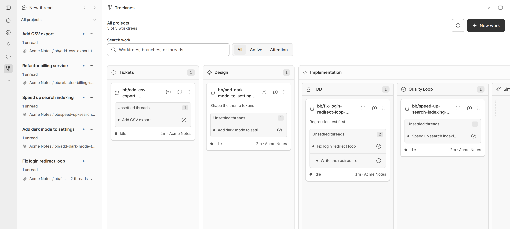
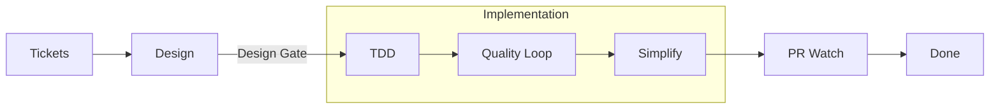
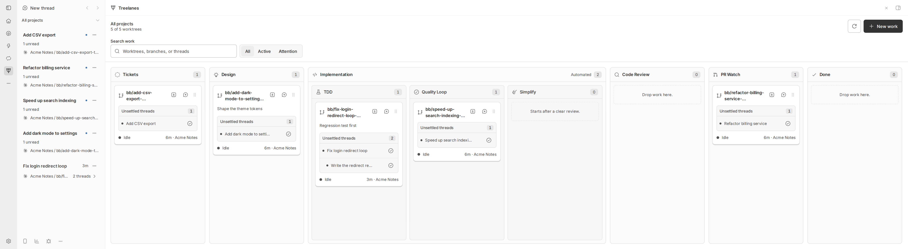
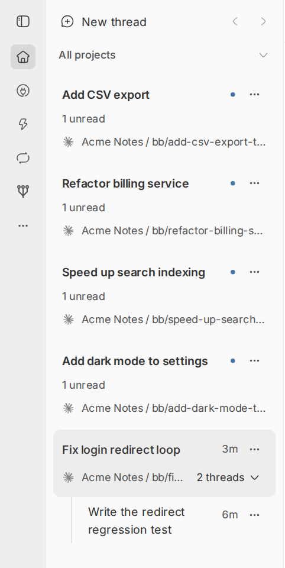
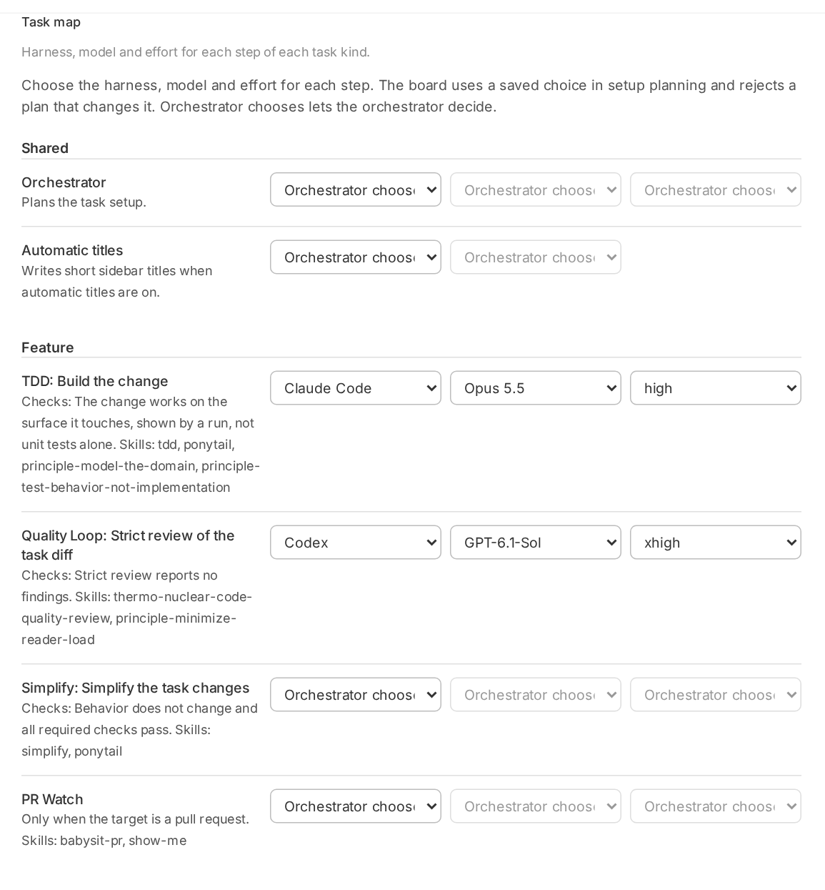

<p align="center">
  <picture>
    <source media="(prefers-color-scheme: dark)" srcset="docs/images/icon-dark.svg">
    
  </picture>
</p>

<h1 align="center">Treelanes</h1>

<p align="center">
  Run many coding agents at the same time, each in its own Git worktree.<br>
  Take each task from idea to merged pull request, with real checks at each step.
</p>

<p align="center">
  <a href="https://github.com/ahmedhesham6/bb-plugin-treelanes/actions/workflows/ci.yml"></a>
  <a href="LICENSE"></a>
</p>

Treelanes is a plugin for [bb](https://github.com/get-bb/bb), an app that runs
coding agents. It adds a board, a sidebar, and a delivery workflow for Git
worktrees.



## Why Treelanes

- **See all your work in one place.** Each Git worktree is one card. The card
  moves from Tickets through Design and Implementation to PR Watch and Done.
- **Agree on the design before code.** Work waits at the Design Gate until you
  accept the design. Then the board starts the build.
- **Proof, not claims.** A stage ends only when its worker sends a Completion
  Receipt: real check results for the current task and the current files. A
  "done" message alone moves nothing.
- **Review until clean.** The Quality Loop reviews and fixes the change until
  the review finds nothing. Then Simplify removes needless code.
- **Your model for each step.** The task map sets the harness, model, and
  effort for each step of each task kind. The board holds each plan to your
  choices.
- **PR Watch until the merge.** An agent pushes the branch, opens the pull
  request, adds screenshots for UI changes, fixes failed checks, and answers
  review comments. You merge.
- **A sidebar for worktrees.** Each worktree shows as one main thread, with its
  other threads below it.
- **Recovery after failures.** The board saves each step, retries a failed turn
  at most twice, and continues after bb restarts.

## How it works



| Stage | What happens |
| --- | --- |
| Tickets | New work waits here. |
| Design | You and an agent shape the work with `/grilling` until the decisions are clear. |
| TDD | An agent writes tests first, then the code. |
| Quality Loop | A strict review finds problems and fixes them. It ends when the review has no findings. |
| Simplify | An agent removes needless code and keeps the behavior. |
| PR Watch | An agent pushes the branch, opens the pull request, and watches checks and reviews until the pull request is ready to merge. |
| Done | bb confirms that the pull request merged. |
| Code Review | A separate lane for a `/code-review` of other changes. It reports findings and changes no code. |

Before each automatic move, the board compares the Completion Receipt with the
saved task, the stage, the required check names, and the worktree files. You
can also drag a card to a stage by hand. [How delivery works](docs/delivery.md)
gives the full rules.

## Requirements

- bb 0.43 or later.
- Git.
- At least one agent harness that bb supports, such as Claude Code or Codex.
- [GitHub CLI](https://cli.github.com) (`gh`), signed in, for PR Watch.

## Install

```sh
bb plugin install git:https://github.com/ahmedhesham6/bb-plugin-treelanes
```

To build from a checkout, read [CONTRIBUTING.md](CONTRIBUTING.md).

## Quick start

1. Open **Treelanes** in the bb navigation to see the board.
2. Optional: choose **Treelanes** under Settings → Appearance → Sidebar. This
   choice applies to the current client.
3. Select **New work**. In the new thread, choose a Git worktree. Then give the
   task with `/delivery`, for example:
   `/delivery Add a CSV export to the notes list`.
4. The agent asks questions in Design until the plan is clear. Accept the
   design, or move the card to TDD.
5. The board runs TDD, Quality Loop, Simplify, and PR Watch. When the pull
   request is ready, review it and merge it.

A new install starts empty. A thread appears on the board when it is in a Git
worktree and is not settled.

## Board



The board ignores threads outside Git worktrees. It hides each Settled
Thread. A card leaves the board when its worktree has no unsettled threads.
New work or attention makes a settled thread appear again.

The worktree owns the stage. Drag a card to assign work by hand. A live stage
worker prevents a conflicting move. Agents keep the Design Gate and Code
Review boundary. For a Saved Task, agents cannot skip forward through
Implementation with the move command.

Automatic moves require a Completion Receipt from the Stage Owner. The board
checks the task revision, stage revision, required check names, and worktree
digest before each move. Missing or incomplete file data prevents a move.
A completion marker alone does not advance work. Done requires bb to confirm
a merged pull request whose head branch matches the worktree.

Select a worktree card to open its newest unsettled thread in the right pane.
Select a listed thread to open that thread. The pane also has an action that
opens the full thread. The board also has search, All, Active, and Attention
views, a New work action, stage buttons in the thread pane, and a small-screen
layout.

## Sidebar



One main thread per Git worktree. Select a main thread to show its children.
Select another worktree to collapse the previous group. Selecting a child keeps
its group open. A collapsed main row shows input requests, failures, running
threads, and unread counts. The sidebar reveals hidden agent children in the
same Git Worktree when they link to a visible thread. Internal plugin threads
stay hidden. Grouping keeps parent links.

Use the row menu for split, read state, pin, archive, delete, settle, snooze,
restore, or "Use as main thread". Drag a main row to move its worktree. Drag a
child to change its order within that worktree. Focus the drag handle and use
arrow keys for keyboard movement.

A saved main-thread choice takes priority. For a new group, the sidebar prefers
the board's initiating thread, then the oldest root in the worktree, then its
oldest visible member. Pinned children raise their worktree into Pinned.
Snoozed and Settled state remains per thread. A group stays in Inbox while any
member has active work.

The thread header shows parent and child chips. PR badges use bb's branch
lookup; a branch without a PR has no badge.

## Settings

Open Settings → Plugins → Treelanes.



- **Task map**: a Settings section that lists the template steps of each task
  kind (feature, bug fix, refactor, perf), with PR Watch when the target is a
  pull request. Each step shows its stage, title, checks, and skills, with
  harness, model, and effort dropdowns from the live catalogs of connected
  harnesses. The orchestrator and automatic titles have their own rows. A
  saved choice binds setup planning and validation for steps that have not
  started; the board rejects a plan that changes it. Settings and
  `bb treelanes health` report a saved choice that the live catalog cannot
  run.
  A saved orchestrator harness that differs from the initiating thread uses
  a new orchestrator thread. Unset model and effort choices use that harness's
  live catalog defaults.
- **Automatic subthread titles**: off by default. When on, the harness and
  model from the task map's titles row write short sidebar titles in a short
  hidden thread. Custom names stay.
- **Wait in Design before automatic delivery**, **Use the initiating thread as
  orchestrator**, **Move finished Grilling to TDD**, **Move through
  Implementation when work finishes**, **Simplify to PR thread**, and the
  stage prompts.

## CLI

```sh
bb treelanes import
bb treelanes stages
bb treelanes show [project-id]
bb treelanes move <stage> [thread-id] [note]
bb treelanes context
bb treelanes task '<JSON>'
bb treelanes complete '<JSON>'
bb treelanes health [project-id]
bb treelanes reconcile [project-id]
bb treelanes pause [environment-id]
bb treelanes resume [environment-id]
bb treelanes snapshot <environment-id>
bb treelanes list-main
bb treelanes main <project> <environment> <thread>
bb treelanes titles
bb treelanes generate-titles
```

Run `bb treelanes help` for the full list, including the delivery commands.
[How delivery works](docs/delivery.md) tells how agents use them.

## Contributing

Issues and pull requests are welcome. Read [CONTRIBUTING.md](CONTRIBUTING.md)
before you start, and follow the [code of conduct](CODE_OF_CONDUCT.md). To
report a security problem, read [SECURITY.md](SECURITY.md).

## Credits

- The sidebar design takes ideas from the sidebar in
  [T3 Code](https://github.com/pingdotgg/t3code).
- The sidebar code started as a copy of an MIT-licensed sidebar plugin by
  Michael Yong. Its license notice is in [sidebar/LICENSE](sidebar/LICENSE).
- The shipped skills come from these authors. Each is under the MIT license,
  and [skills/SOURCES.md](skills/SOURCES.md) lists the source of each skill:
  - Matt Pocock, [mattpocock/skills](https://github.com/mattpocock/skills):
    grilling, tdd, codebase-design, diagnosing-bugs, and code-review.
  - HumanLayer, [humanlayer/skills](https://github.com/humanlayer/skills):
    show-me.
  - Cursor,
    [cursor-team-kit](https://github.com/cursor/plugins/tree/main/cursor-team-kit):
    thermo-nuclear-code-quality-review.
  - Michael Yong, [bb](https://github.com/get-bb/bb): babysit-pr.
  - backnotprop, [pstack](https://github.com/backnotprop/pstack): the
    principle skills and benchmark-checklist.

## License

[MIT](LICENSE)
