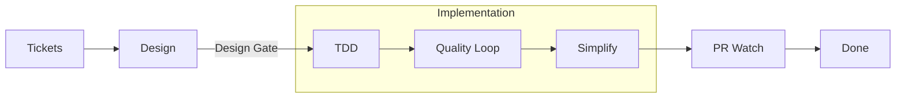

<p align="center">
  <picture>
    <source media="(prefers-color-scheme: dark)" srcset="docs/images/icon-dark.svg">
    
  </picture>
</p>

<h1 align="center">Treelanes</h1>

<p align="center">
  Run many coding agents at the same time, each in its own Git worktree.<br>
  Take each task from idea to merged pull request, with real checks at each step.
</p>

<p align="center">
  <a href="https://github.com/ahmedhesham6/bb-plugin-treelanes/actions/workflows/ci.yml"></a>
  <a href="LICENSE"></a>
</p>

Treelanes is a plugin for [bb](https://github.com/get-bb/bb), an app that runs
coding agents. It adds a board, a sidebar, and a delivery workflow for Git
worktrees.


## Why Treelanes

- **See all your work in one place.** Each Git worktree is one card on one
  board, from the first idea to the merged pull request.
- **Agree on the design before code.** Work waits at the Design Gate until you
  accept the design. Then the board starts the build.
- **Proof, not claims.** A stage ends only on a Completion Receipt: real check
  results bound to the current task and the current files.
- **Your model for each step.** The [task map](#settings) sets the harness,
  model, and effort for each step of each task kind.
- **A sidebar for worktrees.** Each worktree shows as one main thread, with its
  other threads below it.
- **Recovery after failures.** The board saves each step, retries a failed turn
  at most twice, and continues after bb restarts.

## How it works



| Stage | What happens |
| --- | --- |
| Tickets | New work waits here. |
| Design | You and an agent shape the work with `/grilling` until the decisions are clear. |
| TDD | An agent writes tests first, then the code. |
| Quality Loop | A strict review finds problems and fixes them. It ends when the review has no findings. |
| Simplify | An agent removes needless code and keeps the behavior. |
| PR Watch | An agent pushes the branch, opens the pull request with screenshots for UI changes, fixes failed checks, and answers reviews until the pull request is ready to merge. You merge. |
| Done | bb confirms that the pull request merged. |
| Code Review | A separate lane for a `/code-review` of other changes. It reports findings and changes no code. |

- **Move rules** for cards and receipts: [Board](#board).
- **Delivery rules** for setups, checks, retries and recovery:
  [docs/delivery.md](docs/delivery.md).

## Requirements

- bb 0.43 or later.
- Git.
- At least one agent harness that bb supports, such as Claude Code or Codex.
- [GitHub CLI](https://cli.github.com) (`gh`), signed in, for PR Watch.

## Install

```sh
bb plugin install git:https://github.com/ahmedhesham6/bb-plugin-treelanes
```

To build from a checkout, read [CONTRIBUTING.md](CONTRIBUTING.md).

## Quick start

1. Open **Treelanes** in the bb navigation. The board opens; a new install
   starts empty.
2. Optional: choose **Treelanes** under Settings → Appearance → Sidebar. The
   sidebar groups threads by worktree in this client.
3. Select **New work**, choose a Git worktree for the new thread, and give the
   task with `/delivery`, for example
   `/delivery Add a CSV export to the notes list`. A card for the worktree
   appears in Design.
4. Answer the agent's Design questions until the plan is clear, then accept the
   design or move the card to TDD. The card moves to TDD.
5. The board runs TDD, Quality Loop, Simplify, and PR Watch. When PR Watch
   reports the pull request ready to merge, review and merge it. The card moves
   to Done.

## Board


The board shows one card per Git worktree, with the worktree's Unsettled
Threads. All threads in a worktree share its stage. A card leaves the board
when all its threads are settled; new work or attention brings a thread back.

A hand move comes from a drag or `bb treelanes move`:

```text
move card to stage
  stage worker live or starting      → refused
  stage is Done                      → needs a merged pull request for this branch
  saved setup                        → only Design → its first step
  next stage (Design → TDD, TDD → Quality Loop, …)
                                     → moves, and starts that stage's worker
  any other stage                    → moves only
```

An automatic move comes from the Stage Owner:

```text
on Completion Receipt
  task revision, stage revision and worktree digest match the current state
  each required check passed, or has a diagnosed base or environment failure
    → the card moves to the next step, and the board starts its worker
  else
    → not recorded; the card shows the Blocked Attempt
```

Agents keep the Design Gate and the Code Review boundary, and move a Saved Task
through Implementation one stage at a time.

Select a worktree card to open its newest unsettled thread in the right pane.
Select a listed thread to open that thread. The pane also has an action that
opens the full thread. The board also has search, All, Active, and Attention
views, a New work action, stage buttons in the thread pane, and a small-screen
layout.

## Sidebar


One main thread per Git worktree. Select a main thread to show its children.
Select another worktree to collapse the previous group. Selecting a child keeps
its group open. A collapsed main row shows input requests, failures, running
threads, and unread counts. The sidebar reveals hidden agent children in the
same Git Worktree when they link to a visible thread. Internal plugin threads
stay hidden. Grouping keeps parent links.

Use the row menu for split, read state, pin, archive, delete, settle, snooze,
restore, or "Use as main thread". Drag a main row to move its worktree. Drag a
child to change its order within that worktree. Focus the drag handle and use
arrow keys for keyboard movement.

Each worktree picks its Main Thread in this order:

```text
main thread for a worktree
  1. the thread saved with "Use as main thread"
  2. the board's initiating thread
  3. the oldest root thread in the worktree
  4. the oldest visible thread in the worktree
```

Pinned children raise their worktree into Pinned. Snoozed and Settled state
stays per thread. A group stays in Inbox while any member has active work.

The thread header shows parent and child chips. PR badges use bb's branch
lookup; a branch without a PR has no badge.

## Settings

Open Settings → Plugins → Treelanes.


- **Task map**: one row for each template step of each task kind (feature,
  bug fix, refactor, perf), plus rows for the orchestrator and automatic
  titles. Each row picks a harness, model, and effort from the live catalogs.

  ```text
  plan a template step
    saved harness, model, effort  → the plan must use them; a plan that differs is rejected
    "Orchestrator chooses"        → the orchestrator picks from the live catalog
    saved choice not in catalog   → Settings and `bb treelanes health` report it
  ```

  A saved orchestrator harness that differs from the initiating thread starts a
  new orchestrator thread. An unset model or effort uses the harness's catalog
  default.
- **Automatic subthread titles**: off by default. When on, the harness and
  model from the task map's titles row write short sidebar titles in a short
  hidden thread. Custom names stay.

## CLI

`bb treelanes help` lists every command. The ones you use most:

```sh
bb treelanes show [project-id]               # board state
bb treelanes move <stage> [thread-id] [note] # move a card
bb treelanes health [project-id]             # stuck starts, blockers, stale evidence
bb treelanes pause [environment-id]          # stop automatic work for a worktree
bb treelanes resume [environment-id]
```

Agents use the delivery commands that [docs/delivery.md](docs/delivery.md)
describes.

## Contributing

Issues and pull requests are welcome. Read [CONTRIBUTING.md](CONTRIBUTING.md)
before you start, and follow the [code of conduct](CODE_OF_CONDUCT.md). To
report a security problem, read [SECURITY.md](SECURITY.md).

## Credits

- The sidebar design takes ideas from the sidebar in
  [T3 Code](https://github.com/pingdotgg/t3code).
- The sidebar code started as a copy of an MIT-licensed sidebar plugin by
  Michael Yong. Its license notice is in [sidebar/LICENSE](sidebar/LICENSE).
- The shipped skills come from Matt Pocock
  ([mattpocock/skills](https://github.com/mattpocock/skills)), HumanLayer
  ([humanlayer/skills](https://github.com/humanlayer/skills)), Cursor
  ([cursor-team-kit](https://github.com/cursor/plugins/tree/main/cursor-team-kit)),
  Michael Yong ([bb](https://github.com/get-bb/bb)), and backnotprop
  ([pstack](https://github.com/backnotprop/pstack)), all under the MIT license.
  [skills/SOURCES.md](skills/SOURCES.md) maps each skill to its source and
  license notice.

## License

[MIT](LICENSE)
