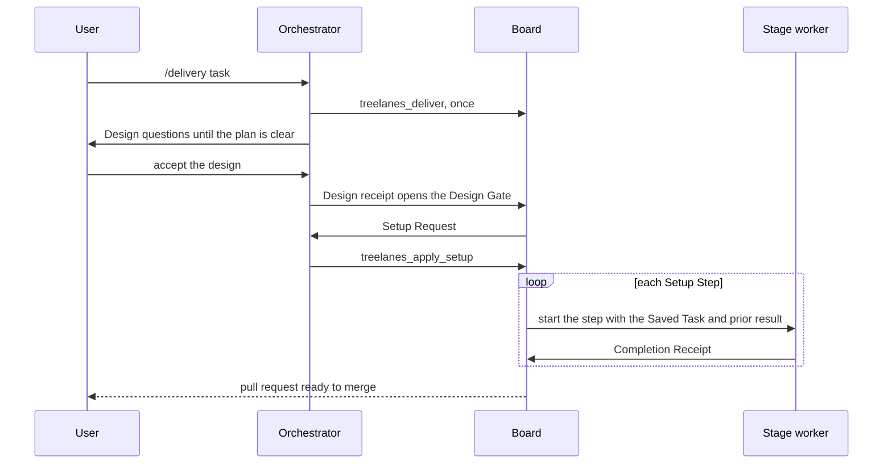
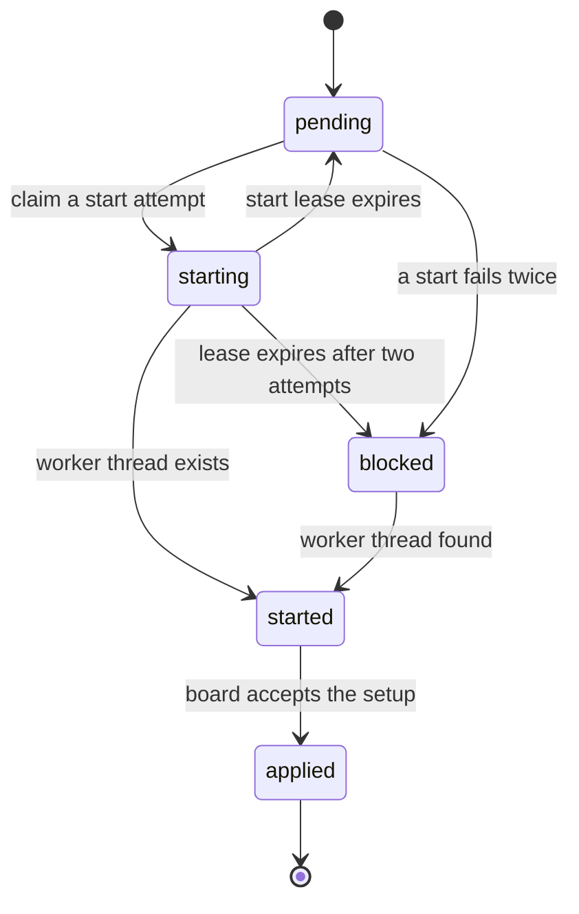
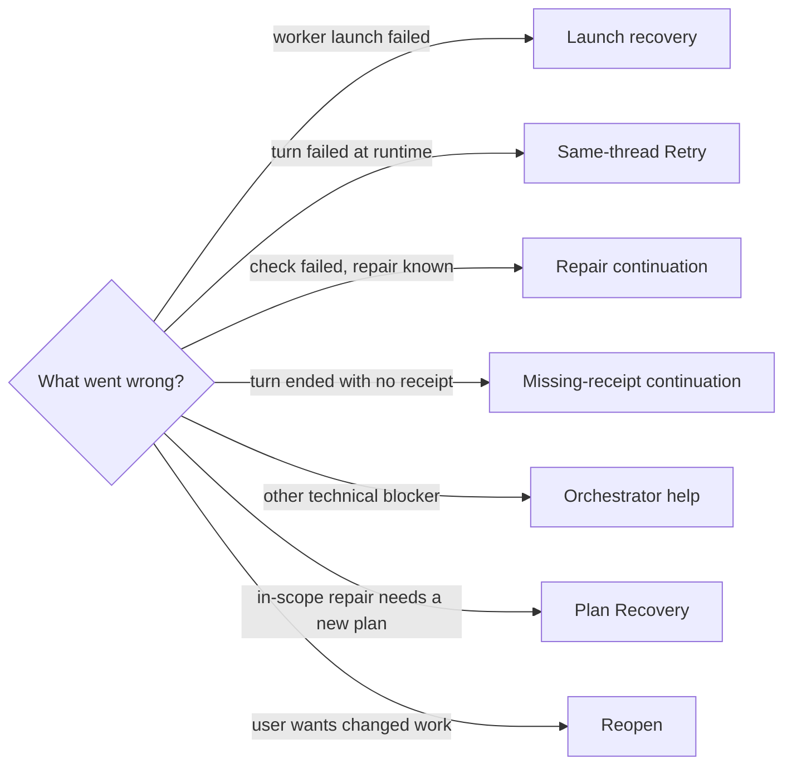

# Delivery rules

These are the rules that the Treelanes board enforces when it plans, starts,
checks and recovers agent work. Words such as Stage Owner and Completion
Receipt have the meanings in [CONTEXT.md](../CONTEXT.md). Workers learn their
part from the [`delivery` skill](../skills/delivery/SKILL.md).

## Roles

- The board alone starts the next stage. It gives each new worker the Saved
  Task and the prior result. The user merges each pull request.
- Only the Stage Owner saves a task or submits a Completion Receipt.
- The worker runs the checks. The board compares the receipt's check names and
  statuses with the required checks.
- Code Review stays outside the delivery chain. A user can assign separate work
  through the panel.
- Orchestrators and stage workers start with visible status, so the sidebar
  shows current work under a hidden parent. Settled and archived states stay
  separate.

## Revisions and receipts

- `context` returns the Stage Owner, task and stage revisions, Saved Task, pause
  state, and current worktree digest. A worktree with no stage returns
  `status: "unassigned"` and creates no card.
- A task change raises the task revision; unchanged task data keeps it. Each
  step, including a repeated stage, gets a new stage revision. A receipt
  advances only the revisions and worktree digest that it names, so an old
  receipt never advances new work.
- `stage-evidence.ts` exports the task and receipt schemas.
- A rejected current result stays saved as a Blocked Attempt. The card and
  health show it, and automatic restarts stop until fresh passing evidence
  clears it.

## Checks

`requiredChecks` apply at every stage. `stageChecks` add named checks for
`design`, `tdd`, `quality` and `simplify`. For example, put a focused
regression in `stageChecks.tdd` and a broader suite in `stageChecks.quality`.
`context` returns the combined check names and `nextStage`, and the next worker
reads them from fresh context.

For PR delivery, a required check can fail with a diagnosed base or environment
failure. A base diagnosis must name the base commit (7 to 40 hex characters).
When the stage has required checks, at least one must pass. When every required
check fails for base or environment reasons, the receipt is not recorded and the
stage waits for the user.

Feature and bug-fix templates add a `bug-hunt` Quality step after Quality and
before Simplify, and require a live call check on the build or fix step. The PR
Watch step requires the `pr-proof` skill.

## Plans

Each task has a `deliveryTarget`. New automatic tasks use `"pr"`: the default
plan is TDD → Quality → Simplify → PR Watch, and PR Watch stays last. An
explicit local-only task uses `"local"`. Its last receipt completes the plan,
the card keeps its last stage, and the card shows "Complete locally. No PR step
is planned." Done always means a verified merge.

### Stage lists

A Saved Task can set `deliveryStages` to an ordered subset of `tdd`, `quality`,
`simplify` and `pr`, for example `["tdd","quality","pr"]` for a small fix or
`["tdd","quality"]` for checked code with no pull request. A plan with TDD
includes Quality. Stages stay unique and in workflow order. A worker can revise
the plan for new findings and keeps the current stage in it. With no plan, the
task uses the full stage chain.

### Task setups

A `setup` replaces `deliveryStages` with explicit steps. `setup-plan.ts` and
`step-execution.ts` hold the schemas:

```ts
type Setup = {
  summary: string;
  steps: SetupStep[];           // 1 to 24; PR Watch only as the last step
};
type SetupStep = {
  id: string;                   // stable across revisions
  title: string;
  stage: "tdd" | "quality" | "simplify" | "pr";   // a stage can repeat
  instructions: string;
  checks: string[];             // at least one, except PR Watch
  execution: {                  // the Execution Choice
    providerId: string;         // the harness
    model: string;              // from the live catalog of that harness
    reasoningLevel: string;     // an effort that the model supports
    skills: string[];           // skill IDs for that harness, or with no harness limit
    reason: string;
  };
};
```

- Common and stage checks add to each step's checks.
- The board rejects a missing or ambiguous choice and puts no default in its
  place.
- Saved task map choices bind the template steps that have not started. The
  [README](../README.md#settings) describes the task map.
- The board stores the resolved choice before dispatch.
  `execution.selectedSkills` holds skill references from board context. It
  limits no tools; the existing permission settings apply.
- The current owner can revise the remaining steps. Completed steps and
  prepared execution settings stay fixed; the task owner can correct a choice
  that failed before dispatch. A changed plan needs a fresh receipt.
- A task update can shorten completed steps. The board keeps their saved
  records and accepts valid changes to current and future steps. Removing,
  reordering or renaming a completed step fails validation.
- The card stage, active step, task versions, launch attempts, resolved
  settings and receipts survive a reload. A stage change and its pending launch
  share one transaction.

`bb treelanes history` shows the latest ten task versions.
`bb treelanes playbooks [project-id]` shows the latest five Checked Setups. A
Checked Setup is an example, not an approval or a receipt for new files. A PR
setup joins the list only after a verified matching merge, and Done needs the
setup to finish.

## Start a task

### Automatic Delivery



- `treelanes_deliver` or `bb treelanes deliver '<json>'` takes
  `{ "stage": "tdd", "task": { ... } }`. The task carries the outcome, scope,
  decisions, constraints, confirmations, checks and allowed actions, with no
  `setup` or `deliveryStages`. The caller ends its turn after it queues the
  request. A repeat of the same request starts no second worker.
- The user can also open the Design Gate by moving the card to TDD.
- The orchestrator is the initiating thread when "Use the initiating thread as
  orchestrator" is on and the task map's orchestrator harness is unset or the
  same. Otherwise the board starts a visible orchestrator thread. It is a
  normal child thread: the SDK has no structured inference call, so Treelanes
  needs no extra service or credential. Later workers are its children.
- The board accepts only the setup proposal; the Saved Task keeps its
  authority. Each step's choices must resolve against the live catalogs. The
  first step starts after the orchestrator is idle.

Each Setup Request moves through durable states:



Before `applied`, a change to the task or stage marks a request `stale`. A
conditional SQL claim stops duplicate starts. After a lost spawn reply, the
claim stays while recovery looks for the worker by its saved title. Once a
thread exists, the board keeps it. A blocked request shows in health.

If the task owner changes the Saved Task before the first plan applies, the
board replaces the Setup Request with one for the current revision. This also
repairs a stale request after a reload. The delivery request stays the same,
this uses no Plan Recovery attempt, and the old planner can no longer submit.
Dispatch waits for other workers and pending input. A stage change does not
restart initial planning. Health reports a stale request for the current stage.

### Manual setup

Inspect choices with `bb treelanes catalog [provider-id] [skill-query]`, save
the task with its setup, then run `bb treelanes start` once.

## Failures and recovery



### Launch recovery

Recovery runs at startup, on settings changes and every five minutes. It uses
saved launch records to recover failed starts and lost completion events. After
a lost spawn reply, it attaches the existing worker. Stale start claims wait two
minutes, and uncertain legacy claims stay blocked for inspection.

Launches stop after three attempts, at least 30 seconds apart. `reconcile` or a
same-stage panel action retries a failed start at once and keeps the attempt
limit. Recovery restarts no idle worker that lacks a receipt, waits for pending
input, and adds no work while threads are active.

### Same-thread Retry

A failed turn of an assigned setup or task worker resumes through
`threads.retry` with its failed turn ID. The retry keeps the thread, Execution
Choice, task revision and stage, and creates no Setup Request.

- The board saves each retry claim before dispatch. Each assignment gets two
  retries, at least 30 seconds apart. `resume` and `reconcile` skip the delay
  and keep the limit; they never resend the same failed turn. Claims survive a
  reload.
- After a lost retry reply, health reports `retry-uncertain`. The board sends
  no repeat and starts no replacement thread.
- Paused work, pending input, queued work and recorded check blockers stop
  automatic retries. Idle or stopped threads stay as they are. Unavailable
  threads stay visible for inspection.

### Continuations

- **Repair**: a failed TDD, Quality or Simplify receipt with `nextAction`
  returns `recorded: false, action: "repair"`. The board keeps the failed
  evidence and sends the action once to the same thread after the turn ends.
  Only fresh passing evidence completes the stage.
- **Missing receipt**: a worker turn that ends normally with no receipt can get
  a bounded continuation in the same thread.
- **Blocker help**: other recorded technical blockers go to the orchestrator for
  diagnosis and child guidance. The orchestrator cannot grant authority or turn
  failed checks into passed checks.

A saved claim stops duplicate sends for the same action, files and task
revision, also after a reload or a lost reply. A pause, pending input, queued
work, a stop or a newer turn cancels an old repair. The card and health show
each repair state.

### Plan Recovery

`treelanes_recover` or `bb treelanes recover '{"reason":"...","nextAction":"..."}'`
asks for a different plan for a concrete repair within the saved scope. A
recorded failed result needs `nextAction`. An unchanged base or external
failure keeps the current plan, and an open human decision blocks recovery.
The worker ends its turn; the board waits for idle state, then plans again in
the same orchestrator.

An Automatic Delivery gets at most two plan changes. Each keeps the completed
steps, the active step ID and stage, every active check, and the common checks,
scope and actions. A new plan gets new task and stage revisions. A failed turn
alone uses Same-thread Retry, not Plan Recovery.

### Reopen

`treelanes_reopen` or
`bb treelanes reopen '{"taskRevision":2,"reason":"User requested changed work"}'`
returns an unpaused automatic task from PR Watch to Design. Only the saved
orchestrator or current owner calls it, and only at the user's request. It
rejects stale revisions, pending setup, other live work and pending input.

Reopen keeps task versions and receipts, clears the active setup, and gives
Design to the original orchestrator. Update the full task in Design, then
complete Design or use an explicit user Start. The board plans fresh steps in
the same orchestrator and keeps PR Watch last. The existing pull request stays
open.

### Pause and health

`pause` stops recovery and automatic moves for a worktree. `resume` clears the
pause and checks the saved state. `health` lists pending starts, failures,
blocked starts, workers waiting for input, and missing or stale evidence.
`health` and `snapshot` report state and start no workers. PR Watch moves to Done after bb confirms the
merge.

## Agent interface

- `treelanes_move_card` takes a stage and an optional note. The plugin finds
  the worktree from the current thread.
- `bb treelanes help` lists every command.
- Stage prompts name `/delivery` and the stage skill, then give assignment
  IDs. Workers read the Saved Task, active step, checks and selected skill
  references from fresh context.
- Setup context omits the worktree digest, so an orchestrator can inspect a
  task when file capture fails. Stage completion still needs the full digest.
